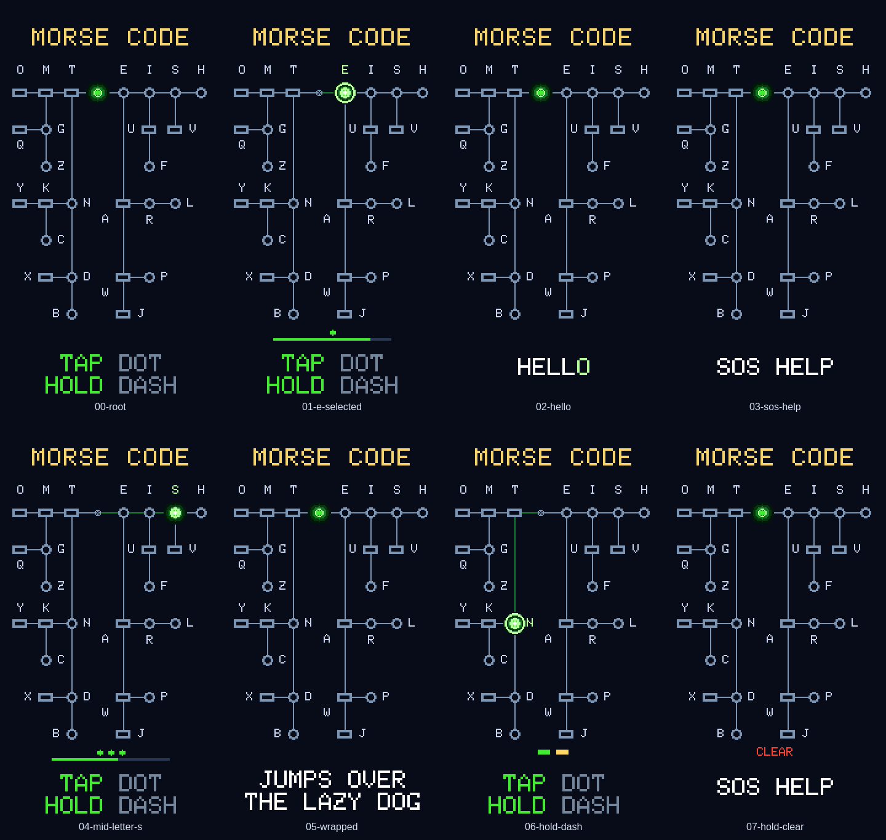

# Morse Code

A pocket Morse-code trainer for the **IdeaSpark ESP32-WROOM** board with its
on-board **1.9″ ST7789 170×320 LCD**. Tap the BOOT button for a dot, hold it for
a dash, and the display walks the A–Z Morse tree while the decoded text builds
up at the bottom.



The look follows [`ui.jpeg`](ui.jpeg): dark navy background, pale-yellow title,
slate circuit-tree with circular (dot) and rectangular (dash) nodes, and a
bright green glow on the node you are currently on.

> **Planned:** LAN messaging between two ESP32s, relayed by a long-running
> Omarchy laptop, with an incoming-message UI and a one-button send flow.
> See [`docs/messaging-plan.md`](docs/messaging-plan.md).
> Phase 0 (the relay server) is in place under [`server/`](server/README.md);
> the firmware side starts in Phase 1.

## Controls

The board has two physical buttons: **BOOT** (GPIO0) and **RESET/EN**.

| Action | Result |
|---|---|
| Tap **BOOT** (< 220 ms) | dot (`·`) |
| Hold **BOOT** (220 ms – 1.5 s) | dash (`−`) |
| Pause 0.7 s after a symbol | commit the current letter |
| Pause 4.0 s after a letter | insert a word space |
| Hold **BOOT** ≥ 1.5 s | open the action menu: `SEND` / `CLEAR` / `READ n` / `CLOSE` (tap cycles, hold picks; `SEND` clears the buffer, `READ n` opens the newest message) |
| In a message: tap | read this message (it is removed) and show the next one |
| In a message: hold ≥ 1.5 s | open the `NEXT` / `CLOSE` menu (tap cycles, hold picks; both remove the shown message) |
| Press **RESET/EN** | clear all decoded text (the board reboots) |
| Serial `MSG <text>` | simulate an incoming message (unique `#id`, `N NEW` badge top-right) |

**About the RESET/EN button.** On the IdeaSpark board the button labelled
`RESET` (the left-hand button) is wired to the ESP32 `EN` pin, not a normal
GPIO. It cannot be read by software, so pressing it reboots the ESP32 — which
also clears the text. The firmware re-initialises the panel without a reset
pulse or `SWRESET`, keeps the last frame in the panel's GRAM, and turns the
backlight on immediately, so the reboot no longer blanks the screen. For a
dedicated clear button that does *not* reboot, wire a momentary switch between
GND and a free GPIO and set `BTN_CLEAR_PIN` in `firmware/src/config.h` (for
example `27`). See [`docs/hardware.md`](docs/hardware.md).

> GPIO0 is also the ESP32 boot-strap pin. Do not hold BOOT while resetting or
> flashing, or the board will enter the serial bootloader instead of the app.

## Relay server

The LAN relay is a Python service in [`server/`](server/README.md). It is
independent of the single-board trainer: the current firmware ignores it until
Phase 1 adds WiFi and an outbox.

```bash
./scripts/init-env.sh   # first run: creates .env with fresh tokens, chmod 600
$EDITOR .env            # set WIFI_SSID + WIFI_PASS, check RELAY_HOST
cd server
uv sync
uv run uvicorn app:app --host 0.0.0.0 --port 8180
```

Run one worker only. Secrets live in `.env` (gitignored); see
[`server/README.md`](server/README.md) for setup, the API, and the smoke test.

Flashing a board copies its slice of `.env` into the firmware:

```bash
./scripts/gen-secrets.py dad    # then make upload, or:
./firmware/build-arduino-cli.sh --device dad --upload /dev/ttyUSB0
```

## How it works

The screen is a stylised A–Z Morse tree:

- **Dot branches go right/down, dash branches go left/down.**
- A **circle** node is a letter that ends in a dot; a **rectangle** ends in a dash.
- The **green halo** marks the current node, and the root-to-node path lights up.
- The **flash ring** confirms every accepted symbol or committed letter.
- The **pattern row** shows the dots/dashes typed for the
  current letter (yellow pulse = the symbol you are currently holding).
- The **thin bar** under the pattern row is the letter-commit countdown.
- The **bottom line** is the decoded text; the newest character flashes green.
  Up to 96 characters are stored, and the last 26 (two rows of 13) are visible.

The renderer composes each frame in a 170×320 `GFXcanvas16` held in RAM and
blits it to the panel in one SPI write. Refreshes never clear the physical
screen first, so there is no black flash when a symbol is entered: the panel
only ever receives complete strips or complete frames.

Idle hints (`TAP DOT` / `HOLD DASH`) are shown until the first character is
decoded.

## Build and flash

### arduino-cli (recommended, no Python needed)

Install the ESP32 core and the two Adafruit libraries once:

```bash
arduino-cli core update-index
arduino-cli core install esp32:esp32
arduino-cli lib install "Adafruit ST7735 and ST7789 Library" "Adafruit GFX Library"
```

Then:

```bash
make check                        # toolchain + /dev/ttyUSB0 sanity check
make build                        # compile only
make upload PORT=/dev/ttyUSB0     # compile + flash
make monitor PORT=/dev/ttyUSB0    # boot log + live key log @ 115200
```

`make` stages the sources into `/tmp/morse-code-sketch` because `arduino-cli`
wants a sketch folder. You can also use the standalone script:

```bash
./firmware/build-arduino-cli.sh
./firmware/build-arduino-cli.sh --upload /dev/ttyUSB0
```

### PlatformIO

```bash
cd firmware
pio run                 # compile
pio run -t upload       # flash
pio device monitor      # serial log
```

The PlatformIO environment uses `board = esp32dev` and
`board_build.partitions = huge_app.csv`.

### Arduino IDE

Open `firmware/src/main.cpp` as a sketch (the three `.cpp`/`.h` pairs must sit
in the same sketch folder), select **ESP32 Dev Module**, and upload. Install
the Adafruit ST7789 and GFX libraries from the Library Manager.

## Host-side UI preview

The renderer (`firmware/src/ui.cpp`) can be compiled on a normal computer
against small Adafruit GFX/ST7789 shims, so you can iterate on the layout
without a camera pointed at the panel:

```bash
make preview
# -> tools/preview/out/preview.png
```

It renders twelve scenes (idle, first dot, `HELLO`, `SOS HELP`, a mid-letter `S`,
wrapped text, a held dash, the armed menu hold, the action sheet, the unread
badge, a message card, and the message `NEXT`/`CLOSE` menu), scales them 2×, and
montages them with ImageMagick. The preview uses the *real* tree table and
renderer, so a coordinate fix there is a coordinate fix on the device.
Requirements: a C++17 compiler and ImageMagick (`magick`).

## Display simulator (live web UI)

`tools/sim/` is an ESP32-device simulation with the display: it links the
*real* `ui.cpp` + `morse.cpp` against host shims and serves a pixel-exact
`170×320` panel in the browser, calling the same API the firmware uses
(`uiBegin / uiFull / uiPattern / uiResult / uiProgress`) with the same input
state machine as `main.cpp`.

```bash
make sim                 # http://localhost:8077/ (PORT_SIM=8080 to change)
make sim-dump            # headless screenshots -> tools/sim/out/*.ppm
./scripts/sim.sh 8077
```

The web UI shows the live framebuffer on a `pixelated` canvas, a virtual BOOT
button (pointer + `Space` key; tap = dot, hold = dash, hold 1.5 s = action
menu), a **receive message** button (`R`) that queues an incoming message with
a unique `#id` and lights the `N NEW` badge, the twelve preview scenes, a text
setter, and a BMP screenshot button. The inbox is newest-first; opening a
message and moving on (`TAP`/ `NEXT`) or leaving it (`CLOSE`) removes it, so
the badge always counts what is left. Endpoints: `GET /api/state`,
`GET /api/frame.raw`, `GET /api/frame.bmp`, `POST /api/press` (`down`/`up`),
`POST /api/scene`, `POST /api/text`, `POST /api/receive` (`{"text":"..."}`),
`GET /api/messages`, `POST /api/clear`.

## Timing and configuration

Everything tunable lives in [`firmware/src/config.h`](firmware/src/config.h):

| Constant | Default | Meaning |
|---|---|---|
| `DOT_MAX_MS` | 220 | release before this → dot, after → dash |
| `DEBOUNCE_MS` | 20 | button debounce |
| `CLEAR_HOLD_MS` | 1500 | hold longer → clear text |
| `LETTER_GAP_MS` | 700 | silence before a letter is committed |
| `WORD_GAP_MS` | 4000 | silence before a space is inserted |
| `BURST_MS` | 240 | node flash-ring duration |
| `RESULT_FLASH_MS` | 350 | new character stays green |
| `PREVIEW_PULSE_MS` | 110 | held-symbol pulse period |
| `PROGRESS_REDRAW_MS` | 40 | countdown-bar refresh period |
| `TEXT_MAX` | 96 | decoded-text buffer size |
| `LCD_BRIGHTNESS` | 160 | backlight PWM (0–255) |
| `DISPLAY_ROTATION` | 2 | 0 / 2 = portrait, flipped 180° |
| `BTN_CLEAR_PIN` | -1 | optional dedicated clear button |

Set `DISPLAY_ROTATION` to `0` if your panel is mounted the other way up. The
firmware sets `invertDisplay(true)` like the reference `esp-status` project; if
your board revision has different colours, that is the first thing to flip.

Tree geometry and label positions are in
[`firmware/src/morse.cpp`](firmware/src/morse.cpp) — each row is
`letter, x, y, labelX, labelY, parent, dotChild, dashChild, shape`.

## Boot log

After flashing, the firmware prints a short banner and every accepted symbol:

```
morse-code v2
reset reason: 1
first frame at 111 ms
input: GPIO0 (BOOT)  clear: RESET/EN button
free heap: 216704
tap = dot, hold = dash, pause = letter, long pause = space
  dot -> E  (len 1)
letter 'E'  text="E"
space
  dot -> E  (len 1)
  dot -> I  (len 2)
letter 'I'  text="E I"
```

## Troubleshooting

| Symptom | Fix |
|---|---|
| No `/dev/ttyUSB0` | Use a **data** USB-C cable; check `dmesg | tail` for `ch341-uart`; install the CH340 driver. |
| `Permission denied` on the port | `sudo usermod -aG uucp $USER` (or `dialout`), then log out/in. |
| Screen stays black | Backlight is GPIO32; check `LCD_BRIGHTNESS`, and that `bringUp()` ran. Try `DISPLAY_ROTATION 0`. |
| Colours look inverted / weird | Flip `invertDisplay(true)` in `firmware/src/main.cpp` or the panel revision differs. |
| Board won't boot after a reset | BOOT may be held: release GPIO0 and press RESET again. |
| Upload can't connect | Hold BOOT, tap RESET, release BOOT, then upload; most boards auto-reset correctly. |
| Text clears when I press the RESET button | Expected: that button is RESET/EN. Use a `BTN_CLEAR_PIN` button for a software-only clear. |
| Long dash clears everything | The old ≥ 1.5 s hold-to-clear is now the action menu (`SEND`/`CLEAR`/`READ`); pick `CLEAR` inside it. Shorten `CLEAR_HOLD_MS`/`ACTION_HOLD_MS` only if you really need slower dashes. |
| Preview fails: `magick: unable to read font` | Install a fontconfig font (`fc-match sans`) or edit `scripts/preview.sh`; the script picks the font file automatically when available. |

## Repository layout

```
firmware/
  platformio.ini              PlatformIO environment
  build-arduino-cli.sh        compile / flash helper
  src/
    config.h                  pins, timing, brightness
    morse.h / morse.cpp       A–Z tree table and child lookup
    ui.h / ui.cpp             framebuffer-style renderer
    main.cpp                  input state machine + Arduino entry points
docs/
  hardware.md                 board, pins, buttons, timing notes
  messaging-plan.md           WiFi messaging architecture and one-button UX plan
  preview.png                 rendered UI scenes
server/                       LAN relay (FastAPI + SQLite), see server/README.md
  app.py                      routes, long-poll notifier
  config.py / config.toml     settings + device list (no secrets)
  db.py / auth.py / models.py storage, tokens, request validation
  tests/                      API + config tests
  scripts/smoke.sh            end-to-end curl acceptance
.env.example                  secret template (copy to .env, gitignored)
scripts/init-env.sh           create .env with random tokens
scripts/gen-secrets.py        generate firmware/src/secrets.h from .env
tools/preview/                host shims + scene renderer
scripts/preview.sh            compile + render + montage
Makefile                      build / upload / monitor / check / preview
ui.jpeg                       visual reference
```
